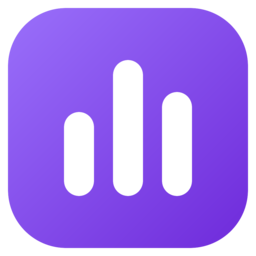

# Nexus Music

A native Windows music player for [Navidrome](https://www.navidrome.org/). It streams from
your own server and is laid out the way Spotify is: library on the left, what you're
browsing in the middle, the player along the bottom.

It is written in Rust with the [Slint](https://slint.dev) UI toolkit. There is no browser
engine inside it: the interface is drawn directly on the GPU, and audio is decoded and played
by the app itself.

What's planned next is in the [roadmap](ROADMAP.md).

## What it does

- Signs in to a Navidrome server; the password is kept in Windows Credential Manager.
- Home, search, albums (sortable), artists, songs (every song in the library, newest first, sortable and filterable), genres, playlists and Liked songs.
- Search that forgives typing mistakes, with a preview of the best matches as you type. It runs on a copy of the library kept on your PC, so it's instant; a matching artist comes first, and songs you've liked rank above others. A short word is only taken for a mistyping of one that starts with the same letter, so four letters don't match half the library.
- Gapless playback or crossfade, seeking, shuffle, repeat and a queue you can edit. Crossfade leaves an album alone: its tracks run into each other as recorded.
- A queue panel beside the page, with a play button on every row to skip straight to it.
  Drag rows to reorder the queue, or the songs in a playlist.
- Find and sort within a playlist or Liked songs: click a column heading to sort by it, including the date each song was added.
- Shuffle is set per playlist or album and remembered.
- Brings playlists over from Spotify: choose the files you exported (CSV from a tool such as Exportify, or Spotify's own data download) and it matches each song to your library, builds the playlists, and lists what it couldn't find.
- Optional, off by default: if you run Lidarr beside your music server, search results gain a "Not in your library" section. It lists songs (each with the album it's on), artists and albums; an artist opens to all their albums and an album to its track list. Asking for a song or album puts that album on Lidarr's list, "Add artist" has Lidarr fetch everything by them, and a Requests page shows what is on its way. A song that never came out on an album is offered on its single or EP (this can be turned off); otherwise whole albums. Where Lidarr gets them from is set up in Lidarr. Songs, discographies and track lists are looked up at [MusicBrainz](https://musicbrainz.org), which is sent what you search for; covers come from the Cover Art Archive. How much each song is played comes from [ListenBrainz](https://listenbrainz.org), which is told which artists and songs came up: the most played go first, an artist's page opens with what they're most played for, and typing an artist's name lists those songs. If Lidarr sits behind an Authentik sign-in, you sign in with your browser and the app keeps only a token (see below).
- With requests on, Home gains "Artists you might like": artists you don't have that are like the ones you play most, each opening to their page. Your server is asked who is similar (it needs Last.fm or Deezer for that, and Navidrome uses Deezer unless told otherwise), and Lidarr says who each one is.
- A "Made for you" row on Home, built from your listening: On repeat, Your top songs, Rediscover and mixes of the genres you play most.
- Follows up what you ask for: when a requested album arrives it says so, lists it under Requests, and puts the songs an imported playlist was missing into that playlist.
- Keeps songs ready: each song is kept on this PC once it has played, and the next few in the queue are fetched ahead of time, so the music carries on through a dropped connection and replays start at once. You choose how much space that may take (2 GB unless changed) and how far ahead to fetch; the songs played longest ago make way when it fills.
- Rides out a bad connection: a stream that stops arriving is asked for again from where it stopped, usually before the audio in hand runs out. If the server can't be reached at all the song waits where it is, the player says it's reconnecting, and the music carries on from the same place when the server is back. Skipping, stopping and seeking still act at once while a stream is stuck.
- Playing a song from a search starts its radio: that song, then others like it.
- Keeps your devices in step: the queue and your place in it, Recently played, pinned playlists, each list's shuffle and sort, the dates songs were added and the theme follow you to the app on another PC. The queue uses the server's saved-queue feature; the rest is kept in the comment of a playlist named "Nexus Music sync".
- Select several songs with Ctrl or Shift, then drag them onto a playlist or the queue, or
  right-click to act on them all.
- Recently played: the last hundred songs, each playable again by itself.
- Autoplay: when the queue ends it carries on with similar songs, falling back to the same
  genre when Navidrome has no similar-song source set up.
- A six-band equaliser with presets, presets of your own, and a preamp that leaves room for
  bands you've raised (automatically, if you like). Mono audio. Volume levelling from
  ReplayGain tags at a quiet, normal or loud target; songs with no tags are turned down by a
  typical amount so they don't stand out.
- Streaming quality from 96 kbps to lossless, switchable mid-song.
- A choice of output device, and exclusive mode: the device runs at each song's own sample
  rate and receives the file's samples unchanged (bit-perfect at full volume with the
  equaliser and levelling off).
- Downloads: save songs, albums and playlists on the PC to play without the server, at a
  quality you choose, with progress shown per song and on the taskbar, and a cancel button.
  Songs that couldn't be fetched are listed on the Downloads page with the reason and a
  "Retry failed" button. You choose the folder they're kept in (Settings, Storage); changing
  it moves them. A download that wouldn't fit on the drive isn't started. Each account has
  its own list of downloads.
- Offline mode, and automatic detection when the server can't be reached: downloads keep
  playing, and likes, ratings and plays are kept on the PC until the server is back and has
  accepted them. A server that answers with an error is treated the same way; only a
  sign-in the server refuses takes you back to the sign-in screen, and the queue is still
  there after signing in again.
- A Now Playing screen with large artwork, the song's format and lyrics or what's next.
- Internet radio stations set up in Navidrome (a station whose stream drops is rejoined), star ratings, and a sleep timer.
- Plays MP3, FLAC, AAC/M4A, ALAC, Ogg Vorbis, WAV and AIFF directly. Anything else (Opus,
  WMA, APE and so on) is converted to MP3 by Navidrome on the fly.
- Create, rename, pin and delete playlists; add and remove songs, with a warning before
  adding one that's already there; like songs and albums.
- Playlists are safe to edit from more than one place. Removing or moving a song is carried
  out on the playlist as the server has it at that moment, by the song and not by its
  position, so a change made on another device in the meantime is kept and the wrong song is
  never removed. "Undo" (or Ctrl+Z) takes the last removal or move back.
- Save the queue, or a "Made for you" mix, as a playlist. Export a playlist as a CSV file
  that this app, and other tools, can import again.
- Synced lyrics, from Navidrome: it serves the ones embedded in a song or in a `.lrc` file beside it. The app doesn't look lyrics up anywhere else, so every app that uses your server shows the same ones. It keeps a copy of what the server says, and fetches the lyrics of the next few songs in the queue ahead of time, so they show the instant you open them and are there when you're offline. To fill in a library that has none, put `.lrc` files beside the songs with a tool such as [LRCGET](https://github.com/tranxuanthang/lrcget).
- A mini player: a small window that stays on top of other apps, with the artwork, the song, and buttons to pause, skip and like.
- "Your stats": what you've played most (songs, artists, albums and kinds of music) and how many hours it comes to, for all time, the last six months or the last four weeks. All time uses your server's play counts; the shorter periods use a log of plays this app keeps on your PC from the day you install this version.
- Recommended songs under each playlist: songs from your library like the ones in it, each with a button to add it.
- Media keys and the Windows now-playing overlay.
- Reports plays to Navidrome, which keeps play counts current and feeds Last.fm or
  ListenBrainz if you linked them there.
- Remembers the queue and position between runs.
- Keeps playing from the notification area when the window is closed (optional), and
  opening it a second time brings back the copy that's already running.
- Checks GitHub for new versions and installs them on request, once the download matches the checksum GitHub publishes for it.
- Its own title bar: navigation, search and the window's buttons in one strip, in the theme's
  colours. Six colour themes and an interface size setting.
- Previous, play and next buttons on the taskbar thumbnail.

### Keyboard

| Keys | What they do |
|---|---|
| Space | Play or pause |
| Left, Right | Back or forward five seconds |
| Ctrl+Left, Ctrl+Right | Previous or next track |
| Ctrl+Up, Ctrl+Down | Volume |
| M | Mute |
| Up, Down, Page Up, Page Down, Home, End | Move through the songs on the page |
| Shift with any of those | Select from where you started to where you've moved |
| Ctrl+A | Select every song on the page |
| Ctrl+Z | Undo the last removal from, or move within, a playlist |
| Enter | Play the song you're on |
| Delete | Take the selected songs out of the playlist |
| Menu key, or Shift+F10 | Open the menu for the selected songs; the arrows and Enter work in it |
| Tab, or F6 | Move the arrow keys to the queue panel and back |
| In the queue: Enter, Delete, Alt+Up, Alt+Down | Play that song, remove it, move it up or down |
| Ctrl+K | Search |
| Ctrl+, | Settings |
| Alt+Left, Alt+Right | Back and forward |
| F5 | Reload the page |
| Esc | Close a menu, clear the selection |

### Requests when Lidarr is behind Authentik

If Lidarr's address answers with an [Authentik](https://goauthentik.io) sign-in instead of
Lidarr, pressing **Connect** notices and opens that sign-in in your browser. You sign in on
Authentik's own page, with whatever second step it asks for, and the browser hands the app a
token. No name or password is typed into the app or kept by it. The token is kept in the
Windows credential store, is replaced each time it's used, and is handed back when you sign
out. It lasts for as long as the app is opened now and then within the lifetime Authentik
gives refresh tokens.

Authentik needs three things set up once:

1. An OAuth2/OpenID provider for the app: public client, client ID `nexus-music`, redirect
   URI `http://127\.0\.0\.1:\d+/callback` (regular expression), grant types Authorization
   Code and Refresh Token, scopes `openid`, `profile` and `offline_access`. Give it an
   application, limited to the people who may use Lidarr.
2. On the proxy provider in front of Lidarr, add that provider under Federated OIDC
   Providers. Who may use Lidarr is still decided by the Lidarr application's own bindings.
3. The reverse proxy has to pass the `Authorization` header on to Authentik's outpost for
   Lidarr's host. With that header passed, Authentik also accepts tokens made from a user's
   app password for that host, so only do this where that is acceptable.

## Installing

Download `NexusMusic-Setup-<version>.exe` from the
[latest release](https://github.com/Comfydata276/nexus-music/releases/latest) and run it. It installs for the current user without an
administrator prompt. The build isn't code-signed, so Windows SmartScreen will ask before
running it the first time: choose **More info**, then **Run anyway**.

Installed copies update themselves from Settings, About. The portable `.exe` on the same
page needs no installation; it tells you when a new version is out and opens the download page.

The app needs the Microsoft Visual C++ runtime, which most PCs already have. If Windows
reports that `VCRUNTIME140.dll` or `MSVCP140.dll` is missing, install it from
<https://aka.ms/vs/17/release/vc_redist.x64.exe>.

## Building

Everything builds inside one Docker image, including the Windows cross-compile, so the host
needs only Docker.

```sh
docker build -f docker/dev.Dockerfile -t nexus-music-dev docker   # once
scripts/package-windows     # Windows .exe and installer, into dist/
scripts/check               # compile for Linux and print diagnostics
scripts/dx cargo test       # unit tests
scripts/release notes.md    # build and publish a GitHub release (bump Cargo.toml and push first)
```

`scripts/dx <command>` runs any command inside the image as your user.

### Running it on Linux for development

The Linux build is for development and testing only. Slint's embedded
[MCP server](https://docs.slint.dev/latest/docs/slint/guide/tooling/ai-coding-assistants/)
lets a script or coding agent inspect the window, click and take screenshots, with no display:

```sh
scripts/dx bash -c 'SLINT_EMIT_DEBUG_INFO=1 cargo build --features slint/mcp'
DX_DOCKER_ARGS="-e SLINT_MCP_PORT=9315 -e SLINT_BACKEND=headless-skia -e NEXUS_MUSIC_HOME=/work/target/test-home" \
  scripts/dx target/debug/nexus-music
```

- `NEXUS_MUSIC_HOME` puts settings and caches in a folder of your choosing.
- `NEXUS_TRACE=1` prints how long each track took to open and to produce its first audio.
- `NEXUS_AUDIO_DUMP=<file>` (only when no sound card is present) records what would have
  been played as raw 32-bit float stereo at 48 kHz, so output can be checked numerically.

## What keeps it quick

Most waiting in a streaming client is connection setup and round trips, so the app is built
to avoid both:

- One HTTP agent serves API calls, artwork and audio, with connections kept open for minutes
  and warmed up at sign-in. Name lookups are cached, and when a name resolves to several
  addresses the one that answers first is used.
- A page is drawn from a single request; extras such as an artist's biography follow.
  Independent requests run in parallel.
- Clicking something draws its header at once from what the clicked item already shows.
- Every page is cached in memory and on disk. A cached page appears immediately and is
  checked against the server in the background. Resting the pointer on an album, artist or
  playlist fetches its page before the click.
- Each cover is requested from the server at one size; thumbnails are cut from it locally.
- FLAC and MP3 tracks start from a single request.

And the thread that draws the window is kept free of anything slow:

- Files are written by a thread of their own. The queue (which can be thousands of songs) is
  written only when it changes; where playback has got to is a few numbers kept beside it.
- Each play adds one line to the play log; the log is never rewritten.
- Searching the library as you type has its own thread and skips any search that more typing
  has already replaced. Asking Lidarr for something, which can take minutes, has its own too.
- A long playlist's stored copy is read back away from the window's thread.
- One song's rows are found by a lookup, not by going through the list on screen.

Settings shows how long connecting to your server takes compared with a request on an open
connection.

## How the code is organised

| Path | What's there |
| --- | --- |
| `ui/` | The interface, in Slint. `types.slint` is the contract with the Rust side. |
| `src/subsonic.rs` | Client for the Subsonic API that Navidrome serves at `/rest`. |
| `src/audio/` | Playback engine: download buffer, decoding, resampling, output device. |
| `src/controller.rs` | Sign-in, navigation and the page on screen. |
| `src/pages.rs` | Turns server responses into page content (runs on worker threads). |
| `src/playback.rs` | Queue, transport, play reporting, lyrics. |
| `src/playlists.rs` | Describes a change to a playlist so it can be applied to the server's copy; CSV export. |
| `src/actions.rs` | Context menus, likes, playlist edits. |
| `src/covers.rs` | Cover art cache, on disk and in memory. |
| `src/media.rs` | Windows media keys and now-playing overlay. |
| `src/lidarr.rs` | Asking a Lidarr server for albums (optional). |
| `src/asked.rs` | Remembers what was requested and spots when it arrives. |
| `src/musicbrainz.rs` | Finds songs, discographies and track lists for music that isn't in the library. |
| `src/gate.rs` | Browser sign-in for a Lidarr that sits behind Authentik. |
| `src/update.rs` | Finds, downloads and verifies new releases. |
| `src/lyrics.rs` | The server's lyrics, kept so they show at once. |
| `src/plays.rs` | The log of plays behind "Your stats". |
| `src/saver.rs` | Writes files in the background, newest version only. |
| `src/listenbrainz.rs` | How much songs, releases and artists are played. |
| `src/discover.rs` | Artists worth a look that the library doesn't have. |
| `src/songcache.rs` | Songs kept as they're played and fetched ahead of the queue. |
| `src/downloads.rs` | Songs saved for offline listening. |
| `src/offline.rs` | Offline mode and changes held until the server is reachable. |
| `src/audio/exclusive.rs` | Exclusive-mode (WASAPI) output on Windows. |
| `src/instance.rs` | One running copy at a time, title bar colour, display scaling (Windows). |
| `src/taskbar.rs` | Buttons on the taskbar thumbnail (Windows). |
| `src/frame.rs` | Replaces Windows' title bar with the app's own top bar. |
| `installer/` | NSIS script for the Windows installer. |

## Licences of bundled work

- Slint is used under its royalty-free desktop licence, which asks for the attribution shown
  in Settings.
- Fonts: Bricolage Grotesque and Hanken Grotesk, SIL Open Font License (`ui/fonts/`).
- Icons: Lucide, ISC License (`ui/icons/`).
